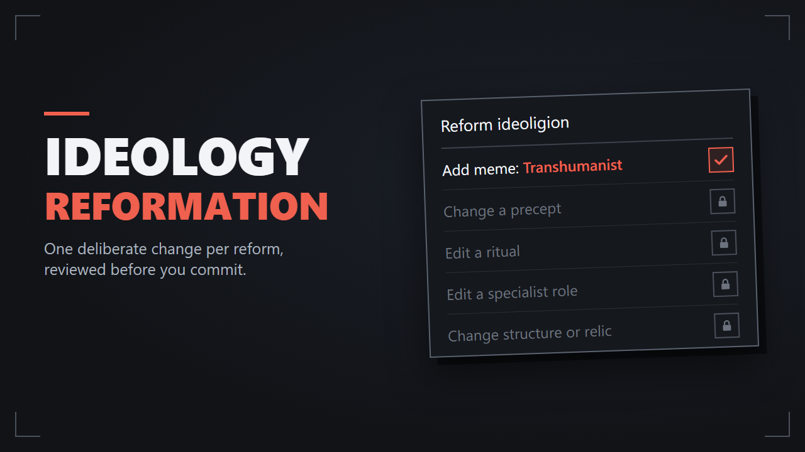

# Ideology Reformation

**Let your colony's beliefs grow one tradition at a time.**

Ideology Reformation makes Fluid ideoligion reforms smaller and clearer. Each reform makes one gameplay change: adding or removing a meme, changing the structure or one precept, or editing one ritual, role, relic or ideoligion building. Names, descriptions, colors, icons and styles stay free to change.

Every reform is reviewed before development points are spent, and can be reset back to how the ideoligion began. When a meme changes, precepts that still fit are kept instead of being rebuilt.

Some memes are unlocked through research, such as Transhumanist after Biosculpting. Locked memes are greyed out with their requirement in a tooltip, research projects list the memes they unlock, and the reform-ready letter names memes that have become available since the last one.

Fixed ideoligions keep vanilla behavior.
